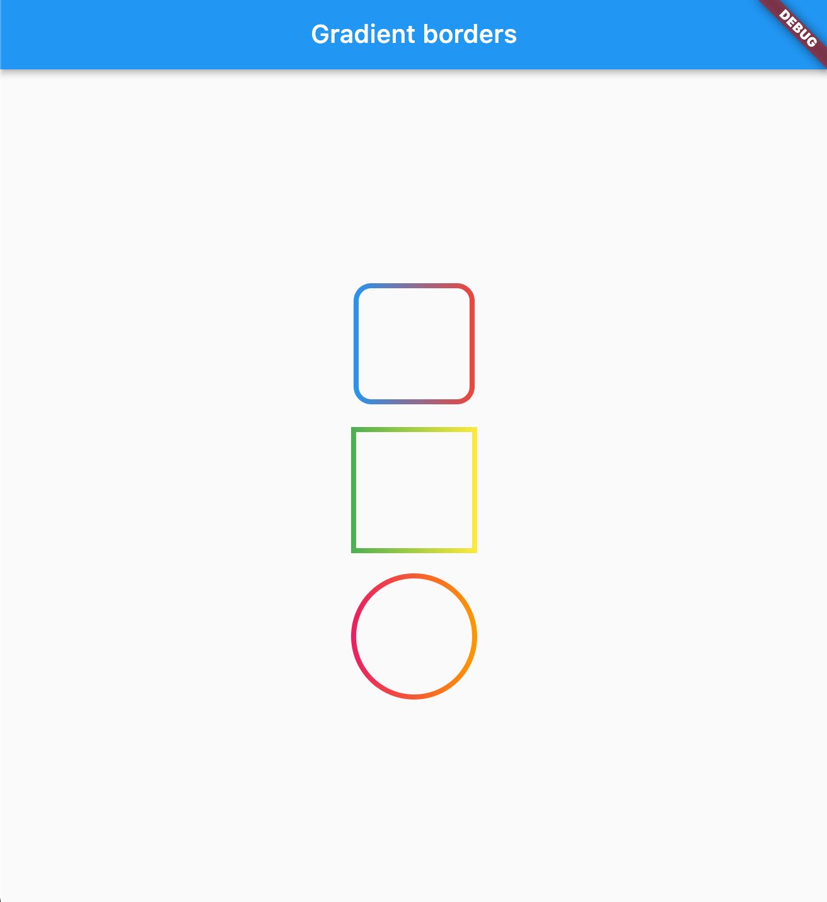
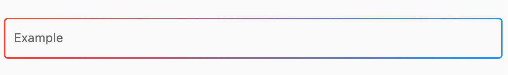

# Gradient borders
[](https://pub.dev/packages/very_good_analysis)

Various borders that use gradient instead of boring plain colors.

## Usage

### Box borders:

Change your container borders to use fancy gradients:
```dart
Container(
  width: 100,
  height: 100,
  decoration: BoxDecoration(
    border: const GradientBoxBorder(
      gradient: LinearGradient(colors: [Colors.blue, Colors.red]),
      width: 4,
    ),
    borderRadius: BorderRadius.circular(16)
  ),
),
```
Works with both: border radius, and with `BoxShape.circle`

#### Parameters

| Parameter     | Type       | Default                        | Description                                                                                                                                                                   |
| ------------- | ---------- | ------------------------------ | ----------------------------------------------------------------------------------------------------------------------------------------------------------------------------- |
| `gradient`    | `Gradient` | required                       | The gradient to use for the border color.                                                                                                                                     |
| `width`       | `double`   | `1.0`                          | The width of the border.                                                                                                                                                      |
| `strokeAlign` | `double`   | `BorderSide.strokeAlignInside` | The alignment of the stroke relative to the border edge. Use `BorderSide.strokeAlignInside` (-1), `BorderSide.strokeAlignCenter` (0), or `BorderSide.strokeAlignOutside` (1). |



#### Animating box borders

On Flutter versions before 3.48, putting `GradientBoxBorder` in an `AnimatedContainer` (or anything else that tweens a `BoxDecoration`) throws during the animation:

```
BoxBorder.lerp can only interpolate Border and BorderDirectional classes.
```

This is a Flutter framework limitation ([flutter/flutter#180297](https://github.com/flutter/flutter/issues/180297)), fixed in [flutter/flutter#186348](https://github.com/flutter/flutter/pull/186348), which first ships in Flutter 3.48. Until you can upgrade, animate the gradient yourself and rebuild a plain `Container`:

```dart
class GradientTween extends Tween<Gradient?> {
  GradientTween({super.begin, super.end});

  @override
  Gradient? lerp(double t) => Gradient.lerp(begin, end, t);
}

TweenAnimationBuilder<Gradient?>(
  tween: GradientTween(
    end: isActive
        ? const LinearGradient(colors: [Colors.green, Colors.pink])
        : const LinearGradient(colors: [Colors.blue, Colors.red]),
  ),
  duration: const Duration(milliseconds: 300),
  builder: (context, gradient, child) => Container(
    width: 100,
    height: 100,
    decoration: BoxDecoration(
      border: GradientBoxBorder(gradient: gradient!, width: 4),
      borderRadius: BorderRadius.circular(16),
    ),
    child: child,
  ),
),
```

`Gradient.lerp` blends smoothly between gradients of the same type. Third-party widgets that use `AnimatedContainer` internally hit the same error and need Flutter 3.48 or newer.

### Input borders
You can use `GradientOutlineInputBorder` as a part of your input decoration:
```dart
TextField(
  decoration: InputDecoration(
    border: GradientOutlineInputBorder(
      gradient: LinearGradient(colors: [Colors.red, Colors.blue]),
      width: 2,
    ),
    focusedBorder: GradientOutlineInputBorder(
     gradient: LinearGradient(colors: [Colors.yellow, Colors.green]),
      width: 2
    ),
    label: Text("Example"),
  ),
),
```

#### Parameters

| Parameter         | Type                     | Default                                | Description                                                                                                                                                |
| ----------------- | ------------------------ | -------------------------------------- | ---------------------------------------------------------------------------------------------------------------------------------------------------------- |
| `gradient`        | `Gradient`               | required                               | The gradient to use for the border color.                                                                                                                  |
| `width`           | `double`                 | `1.0`                                  | The width of the border.                                                                                                                                   |
| `gapPadding`      | `double`                 | `4.0`                                  | Horizontal padding around the label cutout in the border.                                                                                                  |
| `borderRadius`    | `BorderRadius`           | `BorderRadius.all(Radius.circular(4))` | The border radius of the rounded corners.                                                                                                                  |
| `borderAlignment` | `OutlineBorderAlignment` | `OutlineBorderAlignment.onEdge`        | Controls where the stroke is drawn relative to the widget edge. `onEdge` draws the border centered on the widget boundary; `inside` draws it fully inside. |



You can also use `GradientUnderlineInputBorder` as part of your input decoration:
```dart
TextField(
  decoration: InputDecoration(
    border: GradientOutlineInputBorder(
      gradient: LinearGradient(colors: [Colors.red, Colors.blue]),
      width: 2,
    ),
    focusedBorder: GradientUnderlineInputBorder(
     gradient: LinearGradient(colors: [Colors.yellow, Colors.green]),
      width: 2
    ),
    label: Text("Example"),
  ),
),
```

### Sponsored by
[The Code Brothers](https://thecodebrothers.pl)
